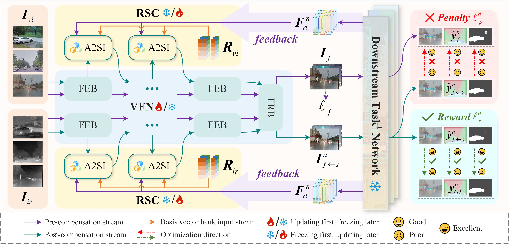

# CLDyN

### Customized Fusion: A Closed-Loop Dynamic Network for Adaptive Multi-Task-Aware Infrared-Visible Image Fusion [CVPR 2026 Oral | Award Candidate]
By Zengyi Yang; Yu Liu*; Juan Cheng; Zhiqin Zhu; Yafei Zhang; Huafeng Li*


## 🔥 News

- 🏆 Our paper has been selected as a [**CVPR 2026 Award Candidate**](https://cvpr.thecvf.com/virtual/2026/events/AwardCandidates2026).
- 🎤 Our paper has been accepted as a [**CVPR 2026 Oral Presentation**](https://cvpr.thecvf.com/virtual/2026/poster/37367).
- 📄 Open-access version is available at the CVPR website: [[Open Access]](https://openaccess.thecvf.com/content/CVPR2026/html/Yang_Customized_Fusion_A_Closed-Loop_Dynamic_Network_for_Adaptive_Multi-Task-Aware_Infrared-Visible_CVPR_2026_paper.html).
- 📄 Our paper is available online: [[arXiv]](https://arxiv.org/abs/2604.08924).

## Overview
<div align=center>

</div>

## Recommended Environment<br>
The recommended environment to run the code:
 - [ ] python = 3.9.0
 - [ ] torch = 2.3.0
 - [ ] torchvision = 0.18.0
 - [ ] cuda = 11.8
 - [ ] timm = 0.9.12
 - [ ] numpy = 1.24.3
 - [ ] scipy = 1.13.1
 - [ ] pillow = 10.3.0
 - [ ] tensorboardX = 2.6.2.2
 - [ ] opencv-python = 4.9.0.80
 - [ ] mmcv = 2.2.0
 - [ ] kornia = 0.5.11
 

## Getting Started
### To Test:
* To obtain the visually guided fused images

        python test_VFN.py

* To obtain the multi-task adaptive fused images

        python test_RSC.py

### To Train:
* Train VFN
    * Prepare training data:

            Dataset name
            ├── train               # Training data
            │   ├── vis             # Visible images
            │   │   ├── ***.png
            │   │   └── ...
            │   ├── ir              # Infrared images
            │   │   ├── ***.png
            │   │   └── ...
            ├── test                # Testing data
            │   ├── vis             # Visible images
            │   │   ├── ***.png
            │   │   └── ...
            │   ├── ir              # Infrared images
            │   │   ├── ***.png
            │   │   └── ...
    * Run:

          python train_VFN.py

* Train RSC
    * Prepare training data:
      * Object Detection Dataset (M3FD):

             M3FD_Detection
             ├── ir               
             │   ├── train          
             │   │   ├── ***.png
             │   │   └── ...
             │   ├── test           
             │   │   ├── ***.png
             │   │   └── ...
             ├── vi                
             │   ├── train              
             │   │   ├── ***.png
             │   │   └── ...
             │   ├── test              
             │   │   ├── ***.png
             │   │   └── ...
             ├── labels                
             │   ├── train             
             │   │   ├── ***.txt
             │   │   └── ...
             │   ├── test              
             │   │   ├── ***.txt
             │   │   └── ...
      * Semantic Segmentation Dataset (FMB):
      
             FMB
             ├── train               
             │   ├── Infrared             
             │   │   ├── ***.png
             │   │   └── ...
             │   ├── Visible              
             │   │   ├── ***.png
             │   │   └── ...
             │   ├── Label              
             │   │   ├── ***.png
             │   │   └── ... 
             ├── test                
             │   ├── Infrared             
             │   │   ├── ***.png
             │   │   └── ...
             │   ├── Visible              
             │   │   ├── ***.png
             │   │   └── ...
             │   ├── Label              
             │   │   ├── ***.png
             │   │   └── ...

      * Salient Object Detection Dataset (VT5000):

             VT5000
             ├── Train               
             │   ├── T_GRAY             
             │   │   ├── ***.png
             │   │   └── ...
             │   ├── RGB              
             │   │   ├── ***.png
             │   │   └── ...
             │   ├── GT              
             │   │   ├── ***.png
             │   │   └── ... 
             │   ├── Edge              
             │   │   ├── ***.png
             │   │   └── ...
             ├── Test                
             │   ├── T_GRAY             
             │   │   ├── ***.png
             │   │   └── ...
             │   ├── RGB              
             │   │   ├── ***.png
             │   │   └── ...
             │   ├── GT              
             │   │   ├── ***.png
             │   │   └── ... 

  * Prepare the code for downstream task networks:
    * The object detection network adopts YOLO:
 
           CLDyN
           └── yolo              
               └── ...             
    * The semantic segmentation network adopts SegFormer:
       
           CLDyN
           └── segformer               
               └── ...             
    * The salient object detection network adopts CTDNet:
       
           CLDyN
           └── ctdnet               
               └── ...             
  * Run:

        python train_RSC.py

## Pretrained Model
*   The pretrained model is provided as follows: [Google Link](https://drive.google.com/drive/folders/1dP8NThXIAn6dQivjINPAia0XBpFSy5wa?usp=sharing)

## Citation
```
@InProceedings{CLDyN,
    author    = {Yang, Zengyi and Liu, Yu and Cheng, Juan and Zhu, Zhiqin and Zhang, Yafei and Li, Huafeng},
    title     = {Customized Fusion: A Closed-Loop Dynamic Network for Adaptive Multi-Task-Aware Infrared-Visible Image Fusion},
    booktitle = {Proceedings of the IEEE/CVF Conference on Computer Vision and Pattern Recognition (CVPR)},
    year      = {2026},
    pages     = {188-198}
}
```
